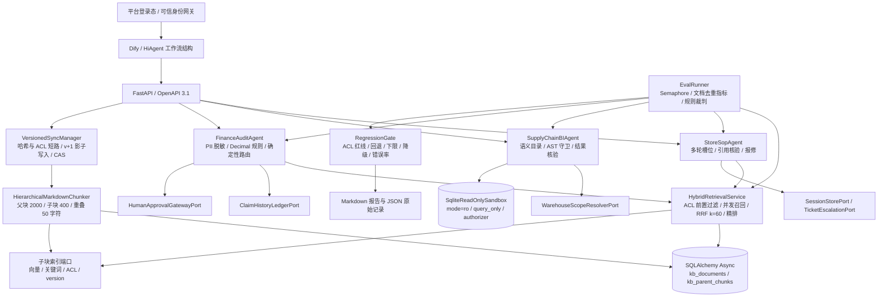

# 连锁餐饮企业 AI 平台

面向万店级连锁餐饮集团的企业级 AI 平台工程：**知识数据中台 + 智能体评测中台 + 三大业务智能体矩阵**。以门店 SOP 问答、供应链经营分析、财务费用与合同预审为场景，把权限、证据、确定性规则、故障降级和回归门禁落实为可执行代码。

当前仓库提供可离线复现的工程实现与验收实验。“万店级”是业务定位；已有报告使用合成语料、内存检索替身和确定性模型，并未验证万店并发容量或生产大模型效果。架构、复现方法与评测边界见下文；各模块接口约定由模型、端口和契约测试共同维护。

## Monorepo 结构

```text
.
├── data_platform/                 # 知识发布与检索
│   ├── connectors/                # 连接器包占位
│   ├── parser_chunker/            # Markdown 层级父子块
│   ├── storage_sync/              # SQL 台账、父块、蓝绿同步、异步端口
│   ├── retrieval_engine/          # ACL、双路召回、RRF、回表、精排
│   ├── adapters/memory.py         # 内存子块检索/精排适配器
│   └── mcp_server/app.py          # FastAPI / OpenAPI 工具层
├── eval_platform/                 # 评分、聚合、归因、回归门禁
│   ├── golden_datasets/           # 餐饮 32 条、SOP 15 条黄金集
│   ├── reports/                   # 检索与门店 SOP 报告与逐样本 JSON
│   ├── evaluators.py              # 文档级检索指标与 ACL 检测
│   ├── runner.py                  # EvalRunner、RegressionGate
│   └── report_generator.py        # Markdown 运营报告
├── agent_matrix/
│   ├── store_sop/                 # 多轮问答、引用核验、报修
│   ├── supply_chain_bi/           # 语义目录、AST、只读 SQL、预警
│   ├── finance_audit/             # Decimal 勾稽、脱敏、引用、审批路由
│   └── workflows/                # 三份 Dify / HiAgent 编排结构说明
├── tests/                        # 796 项参数化展开后的 pytest 测试
│   ├── parser_chunker/            # 15 项
│   ├── storage_sync/              # 28 项
│   ├── retrieval_engine/          # 44 项
│   ├── mcp_server/                # 16 项
│   ├── eval_platform/             # 95 项
│   ├── web_console/               # 150 项
│   └── agent_matrix/              # SOP 106 / BI 183 / 财务 159
│       ├── store_sop/
│       ├── supply_chain_bi/data/  # BI 黄金集、报告、对照 JSON
│       └── finance_audit/data/    # 财务单据、黄金集、制度与报告
├── web_console/                   # 统一管控与演练工作台（FastAPI 入口、离线运行时、原生前端）
├── mock_docs/                     # 虚构培训制度与演示 SOP
└── pyproject.toml / uv.lock       # Python 依赖与锁文件
```

## 系统架构



索引的生产目标是 Milvus / Elasticsearch；当前实测使用内存端口替身。关系存储支持 SQLAlchemy Async，离线实验使用 SQLite；仓库没有可直接启动的完整生产依赖装配。`mcp_server` 当前实现的是 OpenAPI 工具接口，尚无原生 MCP stdio/SSE 服务。三个 YAML 是搭建参考，需要目标平台补齐节点、凭据与工具 provider。

## 核心工程特性

- **版本一致性**：规范化内容 SHA-256 与 ACL 联合短路；父块、向量、关键词并发写入影子版本；SQL CAS 发布后后台 GC。失败清理影子版本，保留已发布版本服务。
- **权限贯穿检索**：先由台账计算可见 `(doc_id, current_version)`，下推部门、角色、版本过滤；召回后复核版本，回表再核对父块的文档与版本。空权限和台账异常均关闭访问。
- **可控异步降级**：向量、关键词分支独立超时；单路失败仍可服务，双路失败返回结构化错误；精排失败回退 RRF。业务智能体按场景保留安全的拒答、模板或人工复核路径。
- **评测可追溯**：检索结果按文档去重计算 Hit@K、Recall@K、MRR；样本指纹保障可比性；系统与裁判 Token 分账；红线样本泄露、错误或缺席都会阻断发布。
- **SOP 受控循环**：仅四处模型调用点；最多两轮追问；饮品数字与单位逐字绑定目标配方；合法引用才放行，安全隐患可直接生成幂等报修工单。
- **BI 双重只读保护**：sqlglot AST 静态检查、可信范围绑定参数、文件级只读 SQLite；最多三次 SQL 尝试，致命违规立即终止；结论数字必须与结果单元格对应，否则退回模板。
- **财务确定性闭环**：Decimal 连续审批区间、税额与发票勾稽、重复占用及拆单检测；模型输入、日志、工单、响应四出口脱敏守卫；模型不能决定自动放行或推翻确定性红线。
- **工程约定**：Python 3.12、uv、FastAPI、Pydantic V2、SQLAlchemy 2.0；18 个 Protocol、124 个 Pydantic 模型；测试包含 Git/AST 契约检查。

## 已提交报告的实测基准

以下为仓库保存的原始结果，不能当作生产模型准确率、真人满意度或压力测试。红线样本不进入检索/回答质量均值；准确率与忠实度口径见各报告的实验说明。MRR 按原 Markdown 精度展示，原始 JSON 有更完整精度；P95 单位为毫秒。

| 实验 | 样本 / 红线 | K | Hit@K | Recall@K | MRR | 回答准确率 | 忠实度 | ACL 拦截 | 错误率 | P95 |
|---|---:|---:|---:|---:|---:|---:|---:|---:|---:|---:|
| 检索评测 关闭精排 | 32 / 8 | 3 | 100.00% | 100.00% | 0.722 | N/A | N/A | 8/8 | 0.00% | 14.07 |
| 检索评测 开启精排 | 32 / 8 | 3 | 100.00% | 100.00% | 0.958 | N/A | N/A | 8/8 | 0.00% | 14.64 |
| 检索评测 规则端到端 | 32 / 8 | 3 | 100.00% | 100.00% | 0.958 | 100.00% | 100.00% | 8/8 | 0.00% | 15.71 |
| 门店 SOP 基线 | 15 / 5 | 5 | 100.00% | 100.00% | 0.883 | 100.00% | **10.00%** | 5/5 | 0.00% | 23.41 |
| 供应链 BI 基线 | 15 / 4 | 5 | 100.0% | 100.0% | 1.000 | 100.0% | 100.0% | 4/4 | 0.0% | 166.8 |
| 财务基线 | 28 / 3 | 5 | 100.0% | 100.0% | 0.697 | 100.0% | 100.0% | 3/3 | 0.0% | 16.2 |

来源：[检索评测 报告](eval_platform/reports/latest_regression_report.md)、[门店 SOP 报告](eval_platform/reports/store_sop_agent_report.md)、[供应链 BI 报告](tests/agent_matrix/supply_chain_bi/data/supply_chain_bi_report.md)、[财务预审 报告](tests/agent_matrix/finance_audit/data/finance_audit_report.md)。

检索评测 精排对比门禁通过；SOP 与 BI 的基线报告标记为“无基线”，财务为基线自比较通过。SOP 的 10% 忠实度来自固定规则裁判对引用标签与拒答模板的已知不适配，原始低分及 85% 下限仍保留。BI 的裁判对照中旧裁判为 0.0000，专用裁判为 1.0000。各套实验的数值幻觉、越权、隐私、规则缺失和模型故障注入均有阻断对照，不能把基线通过扩写为所有候选通过。

## 安装与复现

依赖由 [pyproject.toml](pyproject.toml) 和 [uv.lock](uv.lock) 管理。准备 Python 3.12 与 uv 后，在仓库根目录执行：

```bash
uv sync --frozen --python 3.12
uv run pytest -v
```

全量测试包含 796 项用例，覆盖数据发布、检索、评测、三个业务智能体与工作台。契约测试使用 `main` / `HEAD` 检查公共接口和上游模块，因此需要完整 Git 仓库，并从已提交的干净工作区运行。测试报告写入 pytest 临时目录，不覆盖已提交的评测报告。

如需重新生成检索、SOP 和供应链报告，可在独立克隆中运行以下脚本；默认输出会更新克隆内的报告与 JSON：

```bash
uv run python -m tests.eval_platform.run_catering
uv run python -m tests.agent_matrix.store_sop.run_e2e
uv run python -m tests.agent_matrix.supply_chain_bi.run_e2e
```

财务评测包含基线、规则缺失、隐私泄露、越权注入、模型故障和金额幻觉对照。以下命令将报告保存在指定临时目录的测试子目录中，文件名为 `finance_audit_e2e_report.md`：

```bash
uv run pytest -v tests/agent_matrix/finance_audit/test_eval_e2e.py --basetemp=/tmp/enterprise-finance-eval
```

先运行全量测试，再生成报告，避免报告变化影响上游模块的无侵入性检查。离线实验不需要外部模型密钥或 Milvus / Elasticsearch 服务；报告延迟和时间戳随运行环境变化。

## 可视化工作台

`web_console/` 把上述模块装配成一个本地可运行的中后台界面，无需外部模型密钥、Milvus / Elasticsearch 或前端构建链，页面资源全部来自本地，断网可用：

```bash
uv sync --frozen --python 3.12
uv run python -m web_console
```

启动后访问 <http://127.0.0.1:8000/>。左侧切换模块，顶部显示运行环境，右侧“引擎透视”抽屉展示每次调用的内部状态。每个模块顶部提供 3 个一键用例。

| 模块 | 演示内容 |
|---|---|
| 门店 SOP 督导助手 | 多轮对话、员工身份切换、会话重置；展示溯源引用、`ExtractedSlots`、`LoopStep` 轨迹、`DegradedReason` 与 `trace_id` |
| 供应链经营分析 | 自然语言生成 SQL、sqlglot 放行或拦截徽章、只读沙箱结果表、库存预警；可演示多语句注入拦截 |
| 财务与合同预审 | 报销单或合同文本预审，脱敏前后对比、Decimal 规则命中明细、人工审批工单回执 |
| 知识数据中台检索器 | 按部门与角色检索，展示召回分值、父子块对照与跨部门过滤效果 |
| 评测中台与门禁看板 | 读取已提交的评测报告，展示各智能体指标、失败归因与回归门禁状态 |

### 在线模型模式

未配置 API Key 时工作台保持离线确定性模式。需要接入真实模型时有两种方式，网关须兼容标准 `/chat/completions` 协议：

- 环境变量或 `.env`：复制 `.env.example` 为 `.env`，填写 `LLM_API_KEY`、`LLM_BASE_URL`、`LLM_MODEL`、`LLM_TIMEOUT_SECONDS`，系统环境变量优先于 `.env`。
- 页面配置：点击顶部的模式或模型胶囊打开配置抽屉，可测试连通性并保存生效。页面输入的 Key 只保存在服务进程内存中，重启或清空后回到离线模式（已配置环境变量时，重启会按环境变量重新进入在线模式）。

在线模式只替换三大智能体的模型端口，检索、SQL 守卫与沙箱、财务规则和 PII 脱敏仍在本地执行。用户问题、制度片段、语义字典、查询结果和脱敏后的单据会发送到所配置的网关。顶部“外部调用”统计每一次真实发出的请求，包括失败请求和连通性测试。

运行时真实调用 `VersionedSyncManager`、`HybridRetrievalService`、`SqlStaticGuard`、`SqliteReadOnlySandbox`、`DeterministicFinanceRuleEngine`、`PiiRedactor` 与三大智能体，四个应用工厂挂载在 `/gateway/` 下，由演示网关清洗外部身份头并按所选人员注入可信身份。语言模型位置默认使用 `web_console/adapters.py` 中的确定性适配器，检索使用字符二元组特征的内存索引，供应链数据为启动时写入临时目录的虚构样本，因此界面结果用于演示链路和安全控制，不代表生产模型效果。

## OpenAPI 与平台对接

四个应用工厂可在不注入运行时依赖的情况下导出 OpenAPI 3.1.0，共 9 个业务路由。以财务工具为例：

```bash
uv run --frozen python -c 'import json; from agent_matrix.finance_audit.api import create_app; print(json.dumps(create_app().openapi(), ensure_ascii=False, indent=2))' > /tmp/finance-audit.openapi.json
```

其余工厂：`data_platform.mcp_server.app.create_app`、`agent_matrix.store_sop.api.create_app`、`agent_matrix.supply_chain_bi.api.create_app`。业务请求需要注入各自模型、台账、检索、权限或工单端口；空装配仅能导出 Schema，不能提供完整业务服务。

Agent API 从 `X-User-Id`、`X-Dept-Id`、`X-User-Roles` 构造可信身份并覆盖 body；网关负责认证并清洗外部同名头。知识工具的身份仍来自 `SearchRequest.user_context`，生产接入需可信网关处理。错误统一为 `ToolErrorResponse`，包含错误码、修正提示和可重试标记。财务 `AUTO_APPROVE` 仅表示预审通过并进入常规审批，不表示付款。
